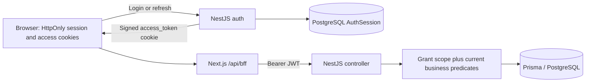

# BFF authentication and authorization architecture

[Documentation index](README.md) · [Conditional grants](04-authorization-and-capabilities.md)

## Request boundaries

The browser calls the same-origin Next BFF. It never receives the JWT in JavaScript; Next reads its HttpOnly cookie and forwards the original token as a bearer credential. The BFF may reject a missing named grant early, but Nest and its scoped database operations are the authoritative boundary. The public Links scaffold is a legacy exception, not a pattern for protected routes.

## Login and credentials

Nest still owns the local mock authorization-code flow, state, PKCE, identity mapping, and session creation. [Next's auth proxy](../apps/web/lib/bff/auth-proxy.ts) forwards browser-facing login, callback, refresh, and logout requests and their Set-Cookie headers. The mock identity provider is disabled when `NODE_ENV=production`; no production provider adapter exists.

- `app_session` is an encrypted, HttpOnly, SameSite=Lax cookie with a random token and one-hour expiry. PostgreSQL stores only its SHA-256 hash, user ID, expiry, and revocation time. It is used for renewal and logout.
- `access_token` is a distinct HttpOnly, SameSite=Lax cookie containing a signed HS256 JWT valid for ten minutes. It contains a backend-built typed grant matrix and stable subject attributes, not executable policy or raw Prisma filters. `AUTH_JWT_SECRET` is independent of `AUTH_COOKIE_SECRET` and is shared only by the two server processes.
- Both cookies are host scoped; `Secure` is added in production. Origin checks protect mutation and refresh requests. Deployment must keep Nest on a private network and protect the signing secret.

[SessionService](../apps/api/src/auth/session.service.ts) loads database role permissions and store assignments at login and refresh. The [backend grant builder](../apps/api/src/auth/authorization-policy.ts) attaches reviewed tenant/store conditions to each supported permission and fails closed for unknown permission codes or unsupported customer grants. [AccessTokenService](../apps/api/src/auth/access-token.service.ts) signs the matrix. The [shared authorization package](../packages/authorization/src/policy.ts) validates claim vocabulary and evaluates grants without depending on Next, Nest, Prisma, or React.

## Each protected request

1. [clientFetch](../apps/web/lib/fetch/client.ts) calls `/api/bff`; the [allowlist](../apps/web/lib/bff/route-policy.ts) maps method and path to a named permission.
2. Next checks the browser Origin for writes, verifies the `access_token` signature, issuer, audience, expiry, and grant shape, then runs `hasPermission()`. It never trusts a browser-supplied Authorization header.
3. Next forwards the original JWT to Nest with `Authorization: Bearer ...` and a trusted Origin. It does not forward the opaque session cookie to protected domain routes.
4. Nest independently verifies the JWT and named grant. It reads current user domain attributes such as region, customer mapping, and refund limit. It does **not** look up `AuthSession` on each domain request.
5. Domain services use `resourceScope()` to translate the same typed grant conditions into tenant/store query predicates. They add current region, customer ownership, stock, order state, and financial limits. Conditional writes repeat the relevant predicates atomically.

`GET /orders/access-summary` is authenticated but has no separate named grant. It returns compact backend decisions for seeded examples. The dashboard sends only coarse permission names to React; it does not expose the signed condition matrix as UI authority.

## Renewal, logout, and bounded staleness

When a protected request returns 401, the browser fetch helper makes one same-origin `POST /auth/refresh` attempt, then retries the original request once. Nest validates the opaque session row, reloads current permissions and assignments, rebuilds grants, and sets a new access-token cookie. It does not extend the one-hour application session. A 403 or business-state rejection does not trigger refresh.

Logout and logout-all revoke one or all current database sessions, clear both browser cookies, and prevent further renewal. An access token copied before logout can still be accepted until its ten-minute expiry; a changed role or store assignment also has that bounded stale window. Current region, customer mapping, and refund limit are reloaded for each Nest request. An already-running request is not cancelled by revocation. Emergency immediate invalidation would require a per-request session/version check or denylist, trading away the no-session-lookup fast path.

## Extending authorization

Adding a protected action requires a reviewed permission in the shared vocabulary, a backend grant-builder rule, a role grant, an explicit BFF route entry, an independent Nest permission check, and a service query using the resolved scope. Existing `equals` and `includes` operators can compare new allowlisted fields once both subject/resource types and query mapping are extended. A new operator requires explicit implementation and tests in both in-memory evaluation and database translation. Missing required resource values deny in `can()`; missing required grant scope denies before a query.

## Verification and limits

API tests cover grant construction, claim validation, JWT verification, current domain attributes, scoped queries, and conditional writes. Web tests cover route mapping and shared grant evaluation. The stateful [retail integration script](../scripts/test-retail.mjs) exercises proxied login, direct Nest bearer enforcement, branch denial, renewal revocation, stale-token behavior, and concurrent stock safety against an isolated demo database.

This is a teaching implementation: mock identity, process-local code consumption, symmetric signing without rotation, public Links routes, no rate limiter, and no PostgreSQL row-level security. The BFF and API must share `AUTH_JWT_SECRET`; asymmetric signing would let Next verify without holding an issuer signing key.
